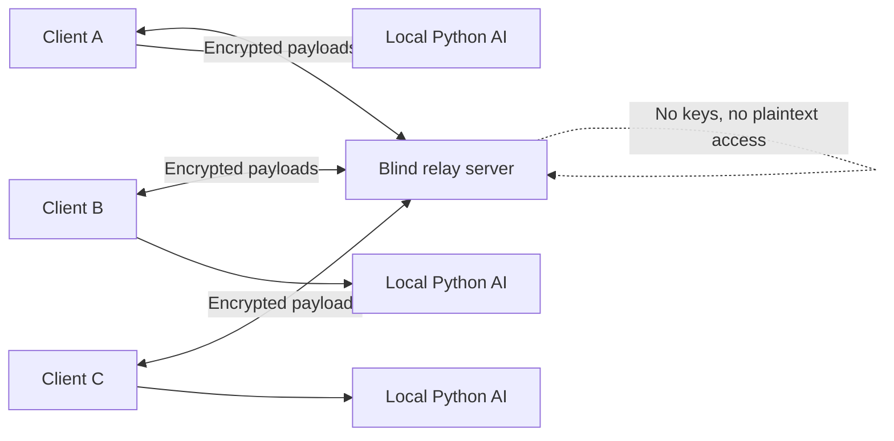

# BastionNet

<div align="center">
  
  <p>
    
    
    
    
  </p>
</div>

BastionNet is a peer-to-broadcast encrypted chat system designed around one principle: the server relays messages without ever being able to read them.

A custom local AI assistant runs alongside the client to help you write, rephrase, and autocomplete text in real time, fully offline and privacy-preserving.

## Why this project matters

- 🔐 End-to-end encryption keeps messages private even from the relay server.
- 📡 Central servers act as blind broadcasters, not content readers.
- 🧠 A local Python AI assistant writes suggestions without sending your data to the cloud.
- 🖥️ The client and server are built with .NET 8, keeping the core system fast and cross-platform.

## Project overview

| Area | Technology | Purpose |
| --- | --- | --- |
| Client | C# / .NET 8 | Chat interface and encryption logic |
| Server | C# / .NET 8 | Relay and broadcast orchestration |
| Shared layer | C# | Crypto primitives and protocol contracts |
| AI assistant | Python | Local autocomplete, rephrasing and writing help |
| Security | AES-256-GCM + ECDH | Protected message exchange |

## Architecture



### How end-to-end encryption works

1. Clients exchange public keys with the server acting as an address/relay directory.
2. A shared AES-256-GCM key is negotiated for the session or group.
3. Messages are encrypted on the sender side and decrypted only by recipients.
4. The server relays ciphertext only; it never sees readable content.

### How the AI assistant works

- A local Python process listens to the text you type in the chat input.
- It produces real-time suggestions, grammar fixes, and rephrasings.
- Suggestions appear inline and can be accepted with a key press or click.
- Your words stay local; nothing is sent to the cloud.

## Features

- 🔐 End-to-end encrypted messaging using AES-256-GCM
- 📡 Blind relay server that broadcasts ciphertext without reading it
- 🧠 Local Python AI assistant with inline completion help
- 🖥️ Cross-platform .NET clients and server
- 🚫 Zero cloud dependency for assistant or message content
- 🛡️ Privacy-first design from transport to suggestion layer

## Repository structure

```text
BastionNet/
├── BastionNet.sln
├── LICENSE
├── README.md
├── CHANGELOG.md
├── SECURITY.md
├── CONTRIBUTING.md
├── CODE_OF_CONDUCT.md
├── CryptoTest/
├── src/
│   ├── BastionNet.AI-Assistant/
│   ├── BastionNet.Client/
│   ├── BastionNet.Server/
│   └── BastionNet.Shared/
├── tests/
└── .gitignore
```

## Getting started

### Prerequisites

- [.NET SDK 8+](https://dotnet.microsoft.com/download)
- [Python 3.10+](https://www.python.org/downloads/)

### Run the server

```bash
cd src/BastionNet.Server
dotnet run
```

### Run the client

```bash
cd src/BastionNet.Client
dotnet run
```

### Run the AI assistant

```bash
cd src/BastionNet.AI-Assistant
python main.py
```

## Roadmap

- [x] Secure peer-to-broadcast messaging model
- [x] Blind relay architecture
- [x] Client and server implemented in C#
- [x] Local AI assistant integration
- [ ] Multi-room chat support
- [ ] Offline delivery queue
- [ ] Improved UX and richer collaboration features

## Contributing

Contributions are welcome. If you want to improve the protocol, strengthen the crypto flow, or make the AI assistant smarter, please open an issue or submit a pull request.

## License

This project is licensed under the [MIT License](LICENSE).

---

<div align="center">
  <sub>Built for private communication, local intelligence, and a cleaner trust model.</sub>
</div>
